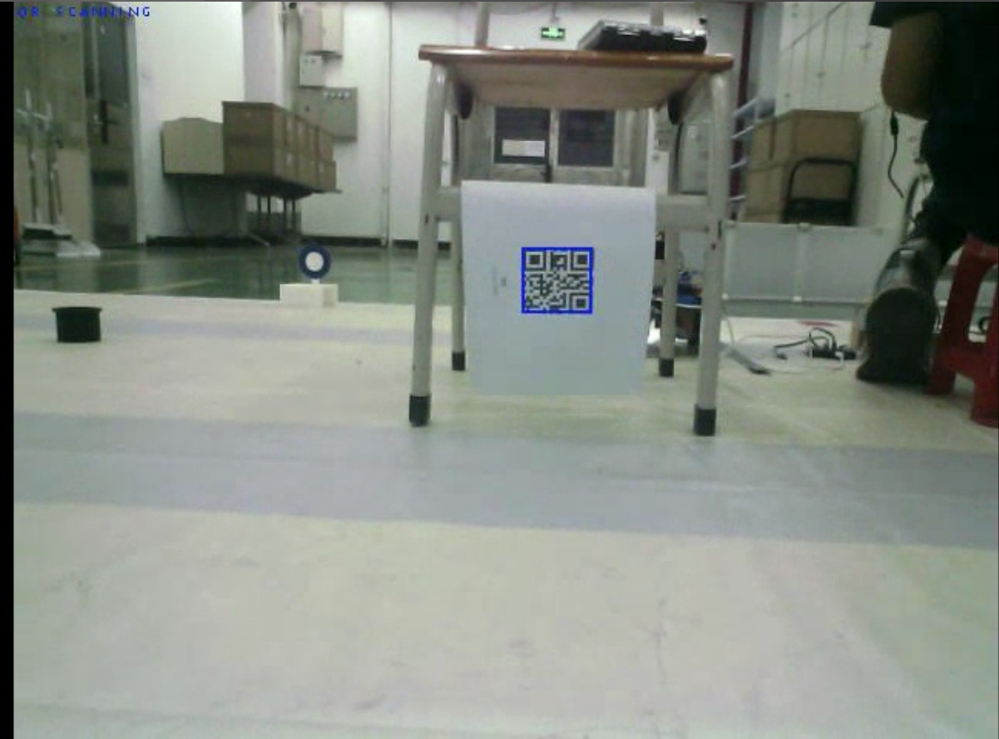
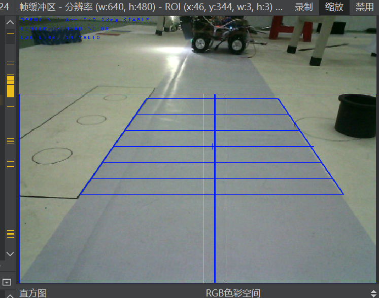

# 工科技能大赛排爆反恐机器人

Engineering Skills Competition — EOD and Counter-Terrorism Robot

本项目保存排爆反恐机器人的 OpenMV 视觉程序、独立测试脚本、STM32 串口联调说明及识别效果图，用于二维码识别、轨道视觉纠偏、小球夹取和目标打靶等任务。后续计划加入基于 K230 的 YOLO 或图像分类模型，实现人质识别。

## 当前项目状态

- 当前仓库主要为 **OpenMV 端代码和接口文档**，不包含完整 STM32 固件工程。
- 根目录 `main.py` 为当前 OpenMV 联调入口，包含二维码、小球夹取、目标任务及视觉纠偏相关逻辑。默认 `OPERATION_MODE = "INTEGRATION"`，可按脚本配置切换为 `DEBUG` 或 `CALIBRATE`；运行前先核对硬件参数和 STM32 协议。
- `main.py历史版本/` 保存之前的集成程序和自动保存版本，仅供参考；其中的启动方式和协议可能与当前独立脚本不同。
- **K230 推理程序、训练数据和模型权重尚未加入本仓库**。YOLO 检测与图像分类为后续候选方案，尚未确定最终模型。
- 各脚本属于不同联调阶段，运行前应核对所用 STM32 程序、命令、引脚和相机参数。

## 硬件与软件

| 部分 | 用途 |
| --- | --- |
| OpenMV H7 Plus | 图像采集、二维码识别、颜色/轨道识别及视觉数据输出 |
| STM32 控制板 | 根据联调协议控制底盘、机构与任务流程，具体以对应固件为准 |
| 舵机、照明及激光模块 | 按选用脚本完成云台、夹爪、补光或打靶测试 |
| OpenMV IDE / 对应 MicroPython 固件 | 编辑、下载与运行 OpenMV 脚本 |
| K230（计划） | 部署人质识别模型并与主控联调 |

大多数测试脚本使用 `sensor`、`image`、`pyb` 等 OpenMV 接口，不能直接在普通电脑的 CPython 环境运行。数据集采集脚本使用 `csi` 接口，需要支持该接口的固件；请按实际设备版本选择。

## 目录结构

```text
.
├── README.md                  # 项目介绍与使用说明
├── main.py                    # 当前 OpenMV 联调入口
├── main_flow.md               # OpenMV 与 STM32 实际联调流程
├── test/                      # 独立任务与硬件测试脚本
├── docs/                      # 串口协议、联调说明和项目报告
├── md/                        # 补充联调资料，部分与 docs 重复
├── main.py历史版本/           # 历史集成代码与自动保存版本
├── 数据集/
│   └── dataset_capture_script.py # 图像采集/预处理示例
└── 效果图/                    # 二维码识别、视觉纠偏效果图
```

`数据集/` 当前仅包含采集脚本，不包含已标注的模型训练数据。Python 缓存、本机 VS Code 配置及 `.env` 文件已通过 `.gitignore` 排除。

## 常用测试脚本

| 脚本 | 用途 |
| --- | --- |
| [qr_standalone.py](test/qr_standalone.py) | 独立二维码测试与 `qr` / `finishqr` 握手 |
| [correction_only_integration.py](test/correction_only_integration.py) | 视觉纠偏与 STM32 联调 |
| [long_track_correction_test.py](test/long_track_correction_test.py) | 长轨道纠偏测试 |
| [long_track_target_integration.py](test/long_track_target_integration.py) | 长轨道到站联调；当前 `target` 仅记录通知，保持激光关闭 |
| [short_long_track_test.py](test/short_long_track_test.py) | 短/长轨道测试 |
| [qr_correction_test.py](test/qr_correction_test.py) | 二维码与纠偏组合测试 |
| [ball_grab_standalone.py](test/ball_grab_standalone.py) | 小球夹取独立测试与握手 |
| [target_shoot_standalone.py](test/target_shoot_standalone.py) | 独立打靶测试 |
| [uart_light_test.py](test/uart_light_test.py) | 串口与灯光测试 |
| [uart_pc_tx_test.py](test/uart_pc_tx_test.py)、[uart_start_pc_test.py](test/uart_start_pc_test.py) | PC 串口收发及启动相关测试 |
| [servo_reciprocating_test.py](test/servo_reciprocating_test.py)、[pan2.py](test/pan2.py) | 舵机与云台测试 |
| [laser_test.py](test/laser_test.py)、[light.py](test/light.py) | 激光与灯光模块测试 |

## 快速开始

1. 在 OpenMV IDE 中连接 OpenMV，相机固件需支持所选脚本使用的接口。
2. 打开一个独立脚本，先阅读脚本顶部注释及对应的 `docs/` 说明。
3. 核对 `UART_ID`、`UART_BAUD`、相机方向、舵机引脚、角度范围及颜色阈值等参数。
4. 对提供 `RUN_MODE` 的脚本，按需求选择 `TEST` 或 `LINK`。例如二维码脚本当前默认 `LINK`，小球脚本当前默认 `TEST`；不同脚本的测试模式行为以其实现为准。
5. 在 IDE 中运行并查看串口日志、图像叠加和任务状态。先验证独立功能，再与 STM32 联调。
6. 如需脱机运行，将已验证的根目录 `main.py` 或所选独立脚本通过 IDE 保存到设备端 `main.py`。使用集成入口时，先确认 `OPERATION_MODE` 和任务握手与 STM32 固件一致。

颜色 LAB 阈值、ROI、轨道中心偏移、相机安装方向和舵机角度均需按现场光照与机械结构标定，历史参数不能直接作为比赛最终参数。

## OpenMV 与 STM32 串口接口

常用配置为 **115200、8N1**，OpenMV 使用 **UART1**，STM32 使用 **USART3**。按现有 H7 Plus 联调说明接线：

| OpenMV | STM32 | 说明 |
| --- | --- | --- |
| P1 / TX | PD9 / USART3 RX | OpenMV 发送到 STM32 |
| P0 / RX | PD8 / USART3 TX | STM32 发送到 OpenMV |
| GND | GND | 双方共地 |

引脚对应以实际板卡及固件配置为准。以下是常见命令，不代表每个脚本都实现了全部任务：

| 方向 | 命令 | 含义 |
| --- | --- | --- |
| STM32 → OpenMV | `qr` | 请求二维码识别 |
| OpenMV → STM32 | `finishqr` | 二维码任务完成 |
| STM32 → OpenMV | `rectify` / `finishrectify` | 开始 / 结束纠偏 |
| OpenMV → STM32 | `VERR 1 x theta quality age` | 有效视觉误差及质量、数据年龄 |
| OpenMV → STM32 | `VERR 0 0.0 0.0 0 0` | 无有效轨道数据 |

固定命令与 `VERR` 数据的解析规则不同；具体发送结束符、接收缓冲和任务时序请参考对应协议。部分历史脚本使用 `START` 或其他握手，不能与当前 `qr` 流程直接混用。

上表汇总不同联调脚本的常用协议。当前根目录 `main.py` 的接收命令以其 `COMMANDS` 和 `handle_command()` 为准；文件顶部关于 `correct` 的历史注释与当前命令列表存在差异，不能仅按该注释发送纠偏命令。

优先阅读：

- [实际联调流程](main_flow.md)
- [OpenMV 串口收发协议](docs/OpenMV串口收发协议.md)
- [视觉纠偏联调协议](docs/视觉纠偏联调协议.md)
- [独立二维码测试说明](docs/独立二维码测试说明.md)
- [独立小球夹取联调说明](docs/独立小球夹取联调说明.md)
- [独立打靶测试与联调说明](docs/独立打靶测试与联调说明.md)
- [STM32 底盘控制移交说明](docs/STM32底盘控制移交说明.md)

## 效果图

### 二维码识别



### 视觉纠偏



## 后续扩展

K230 人质识别代码与模型由项目作者后续补充。
