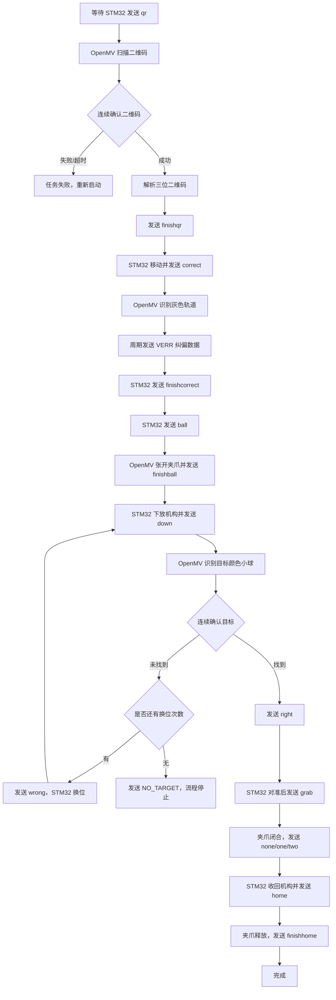

# OpenMV 二维码、纠偏与小球夹取流程

## 1. 系统角色

- **OpenMV**：识别二维码、计算轨迹偏差、识别目标颜色、控制夹爪。
- **STM32**：控制底盘移动、升降机构、转向和机械臂动作，并通过 UART1 与 OpenMV 通信。
- **通信接口**：UART1，`115200 8N1`。

## 2. 总体流程



## 3. 二维码格式

二维码必须是三位 ASCII 数字，例如：

```text
123
```

字段含义：

| 位数 | 含义 |
|---|---|
| 第 1 位 | 目标小球颜色：`1`、`2` 或 `3` |
| 第 2 位 | 目标颜色/任务字段，由比赛规则定义 |
| 第 3 位 | 形状/任务字段，由比赛规则定义 |

OpenMV 当前使用二维码第 1 位选择颜色阈值。

## 4. 通信命令

### STM32 发送给 OpenMV

| 命令 | 作用 |
|---|---|
| `qr` | 开始二维码识别 |
| `correct` | 开始轨迹纠偏 |
| `finishcorrect` | 停止轨迹纠偏 |
| `ball` | 开始小球夹取流程，OpenMV 张开夹爪 |
| `down` | STM32 完成下放和前进后，开始识别小球 |
| `grab` | STM32 已对准小球，执行夹取闭合 |
| `home` | STM32 收回机构，执行释放动作 |
| `stopcorrect` | 立即停止纠偏 |
| `route_reset` | 复位并结束当前任务 |

### OpenMV 发送给 STM32

| 数据 | 作用 |
|---|---|
| `finishqr` | 二维码识别成功 |
| `VERR 1 x theta quality age` | 有效轨迹纠偏数据 |
| `VERR 0 0.0 0.0 0 0` | 当前帧未获得有效轨迹 |
| `finishball` | 夹爪已张开，可以下放机构 |
| `right` | 当前位找到目标小球 |
| `wrong` | 当前位未找到目标，执行换位 |
| `none` / `one` / `two` | 小球夹取成功，并报告换位次数 |
| `finishhome` | 机构已收回并完成释放 |

所有命令均以 `\r\n` 结尾。

## 5. 纠偏阶段

OpenMV 在收到 `correct` 后：

1. 将俯仰舵机调整到纠偏角度。
2. 识别灰色轨道左右边界。
3. 计算横向误差 `x` 和航向角误差 `theta`。
4. 周期发送：

```text
VERR 1 x theta quality age
```

示例：

```text
VERR 1 -12.5 3.2 80 35
```

字段含义：

- `x`：轨道中心横向误差。
- `theta`：轨道方向角误差。
- `quality`：检测质量，通常为 `80` 或 `45`。
- `age`：图像采集到发送之间的毫秒数。

收到 `finishcorrect` 后，OpenMV 停止发送有效纠偏数据。

## 6. 小球夹取状态机

```text
IDLE
  └─ ball
      └─ OPEN_200
          └─ finishball
              └─ WAIT_DOWN
                  └─ down
                      └─ SCAN_SETTLE
                          └─ SCAN
                              ├─ 连续识别成功 → right → WAIT_GRAB
                              │                         └─ grab
                              │                             └─ CLOSE_80
                              │                                 └─ none/one/two → WAIT_HOME
                              │                                     └─ home
                              │                                         └─ finishhome → DONE
                              └─ 识别失败 → wrong → WAIT_DOWN
```

### 夹爪角度

| 阶段 | 角度 |
|---|---:|
| 初始张开 | `200°` |
| 夹取闭合 | `80°` |
| 收回后释放 | `140°` |

实际角度方向由 `CLAW_REVERSE` 配置决定。

## 7. 识别参数

在 `main.py` 中可调整：

```python
BALL_OBJECT_ROI = (0, 180, 320, 60)
BALL_CONFIRM_HITS = 3
BALL_SCAN_TIMEOUT_MS = 2500
BALL_COLORS = {...}
```

- `BALL_OBJECT_ROI`：小球识别区域。
- `BALL_CONFIRM_HITS`：连续识别多少帧才判定成功。
- `BALL_SCAN_TIMEOUT_MS`：单个位置的识别超时时间。
- `BALL_COLORS`：三种颜色的 LAB 阈值。

## 8. 联调顺序

1. 确认 OpenMV 使用 `OPERATION_MODE = "INTEGRATION"`。
2. 确认 STM32 和 OpenMV 均使用 UART1、115200 波特率。
3. STM32 发送 `qr`，确认收到 `finishqr`。
4. STM32 发送 `correct`，确认持续收到 `VERR`。
5. STM32 发送 `finishcorrect`。
6. STM32 发送 `ball`，确认收到 `finishball`。
7. STM32 完成下放和前进后发送 `down`。
8. OpenMV 找到小球后发送 `right`。
9. STM32 对准后发送 `grab`，确认收到 `none`、`one` 或 `two`。
10. STM32 收回机构后发送 `home`，确认收到 `finishhome`。

## 9. 故障处理

- 二维码超过约 28 秒未确认：OpenMV 报告二维码超时，需要双方重新启动。
- 轨道无法识别：OpenMV 发送 `VERR 0 0.0 0.0 0 0`，STM32 应保持安全动作。
- 三个位置都未找到小球：OpenMV 停止发送新的 `wrong`，进入 `NO_TARGET` 状态。
- UART 发送失败或 STM32 报错：停止当前流程，检查供电、共地、TX/RX 连接和波特率。
